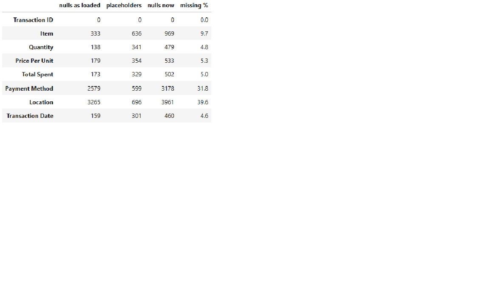
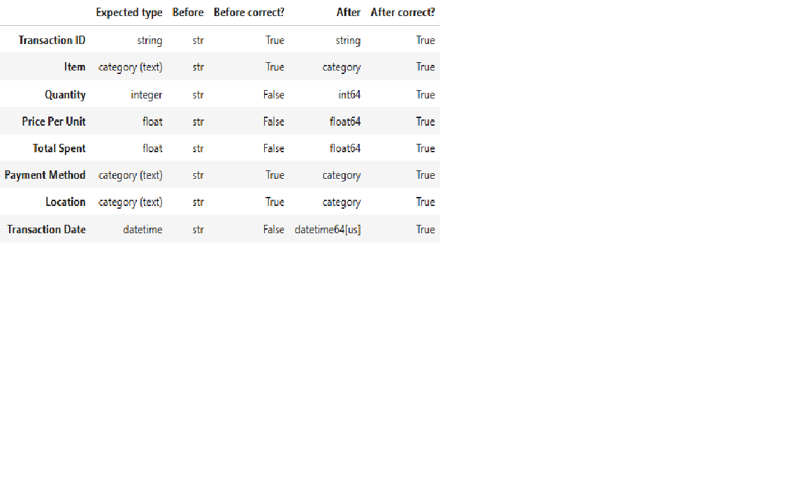
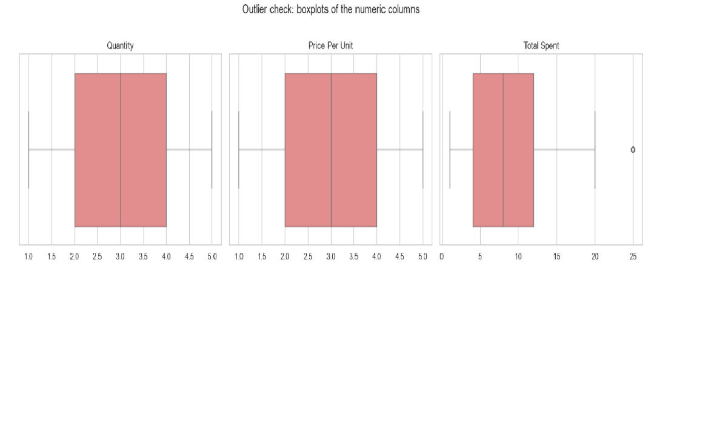
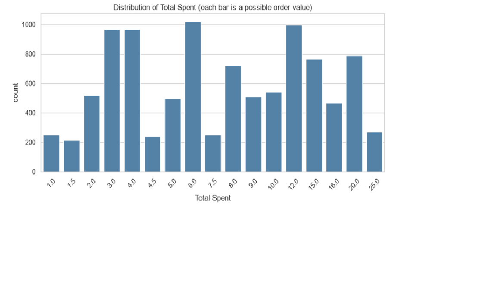
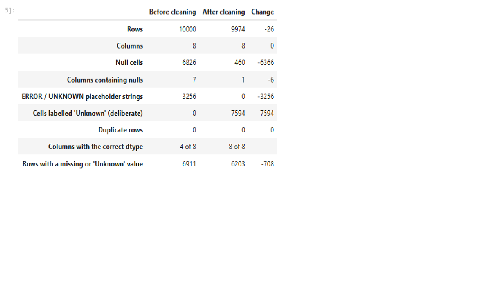
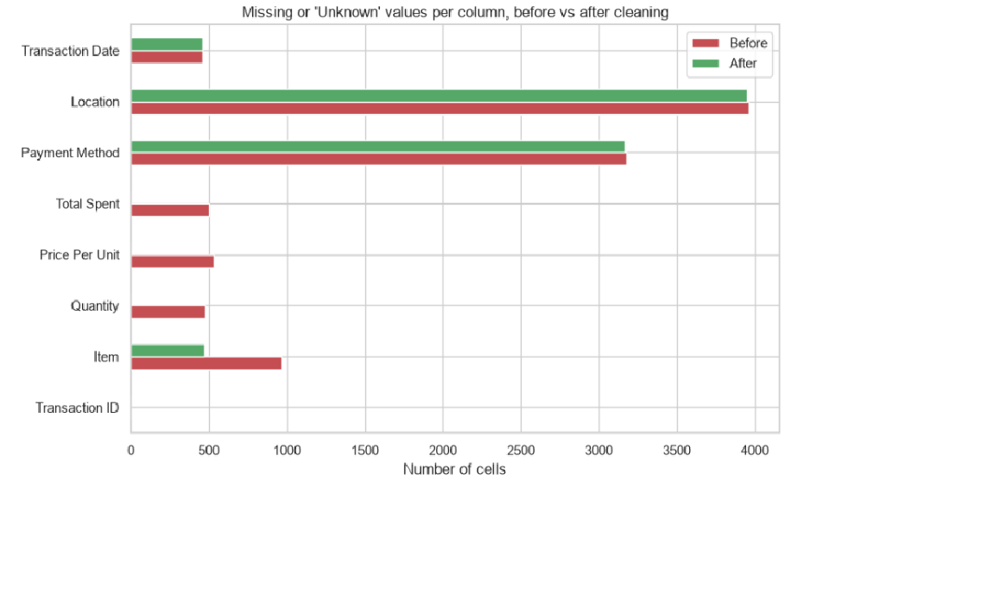

# Task 3 · Cleaning Data

**Track:** Data Analytics · **Level:** 1 · **Internship:** OIBSIP

## Objective
Take a deliberately messy dataset and turn it into a clean, analysis-ready one, documenting every decision: data quality report, missing-data strategy, duplicate removal, standardisation, outlier detection, data type correction, a before-versus-after summary and a saved cleaned file.

## Tech Stack
Python, pandas, numpy, matplotlib, seaborn, Jupyter Notebook

## Dataset
"Cafe Sales - Dirty Data for Cleaning Training" (Kaggle): 10,000 transactions, 8 columns (Transaction ID, Item, Quantity, Price Per Unit, Total Spent, Payment Method, Location, Transaction Date).

The raw file is not included in this repository. Download it from Kaggle (search the title above) and place `dirty_cafe_sales.csv` in the `data/` folder.

## Project Structure
```
DataAnalytics-L1-DataCleaning/
├── Task3_Data_Cleaning.ipynb
├── README.md
├── requirements.txt
├── data/            (place the raw CSV here)
├── output/          (cleaned dataset and summary table)
└── screenshots/     (key tables and charts)
```

## How to Run
```bash
pip install -r requirements.txt
jupyter notebook Task3_Data_Cleaning.ipynb
```
Then run all cells from top to bottom (Kernel → Restart & Run All). The cleaned file is written to `output/cleaned_cafe_sales.csv`.

## What the Notebook Covers
- [x] Data quality report: nulls per column, hidden placeholders, duplicates, data type problems, value ranges
- [x] Missing-data strategy chosen and justified for every column
- [x] Duplicate detection and removal (with the count documented)
- [x] Standardisation of text, placeholders and dates
- [x] Outlier detection with the IQR and z-score methods, with a decision per column
- [x] Data type correction for every column
- [x] Before-versus-after summary table
- [x] Cleaned dataset saved to CSV and checked by reloading it

## Data Quality Findings (before cleaning)
- **10,082 of 80,000 cells (12.6%) were effectively missing.** pandas counted only 6,826 nulls; another 3,256 cells held the text `ERROR` or `UNKNOWN`, which `isna()` does not detect.
- **69.1% of rows (6,911) had at least one gap**, so deleting incomplete rows would have destroyed most of the data.
- Payment Method (31.8%) and Location (39.6%) were the worst columns.
- **Every column loaded as text:** only 4 of 8 had an acceptable type. Quantity, Price Per Unit, Total Spent and Transaction Date were stored as text.
- **No duplicates** (0 rows, 0 repeated IDs) and **no case or spacing inconsistencies** were present.

## Cleaning Approach
| Step | Decision |
|---|---|
| Placeholders | `ERROR` and `UNKNOWN` converted to proper missing values |
| Quantity, Price Per Unit, Total Spent | **Recovered exactly, not estimated.** Total = Quantity x Price held in 100% of the 8,544 complete rows, and each item has one fixed menu price |
| Item | Recovered from the price where the price identifies one item (1.0, 1.5, 2.0, 5.0); labelled "Unknown" where it fits two (3.0 and 4.0) |
| Payment Method, Location | Labelled "Unknown": nothing predicts them, categories are evenly split, and mode imputation would invent thousands of values |
| Transaction Date | Left missing: rows are not in date order, so forward fill would be invalid |
| Unrecoverable rows | 26 rows (0.26%) missing two numeric fields in an unresolvable combination were deleted |
| Duplicates | None found, before or after recovery |
| Outliers | 268 Total Spent values flagged by the IQR rule were **retained**: all are 5 Salads at 5.0 = 25.0, the largest total the menu allows; the z-score method flags nothing, and capping would create an impossible value |

## Results

| Metric | Before | After |
|---|---|---|
| Rows | 10,000 | 9,974 |
| Null cells | 6,826 | 460 |
| Columns containing nulls | 7 | 1 |
| ERROR / UNKNOWN placeholder strings | 3,256 | 0 |
| Cells labelled "Unknown" (deliberate) | 0 | 7,594 |
| Duplicate rows | 0 | 0 |
| Columns with the correct data type | 4 of 8 | 8 of 8 |
| Missing or "Unknown" cells | 10,082 | 8,054 |

- **1,462 of 1,514 missing numeric values (96.6%) were recovered exactly.**
- The dataset is **analysis-ready, not complete**: 62.2% of rows still contain at least one missing or "Unknown" value, mostly in Payment Method and Location, so analyses by those columns must treat "Unknown" as its own group.

## Output
- `output/cleaned_cafe_sales.csv`: cleaned dataset, 9,974 rows and 8 columns
- `output/before_after_summary.csv`: the before-versus-after table

Load the cleaned file with `pd.read_csv("output/cleaned_cafe_sales.csv", parse_dates=["Transaction Date"])`.

## Limitations
- The recovery relies on a pattern verified in the complete rows (fixed menu prices, Total = Quantity x Price); it cannot be tested on the recovered rows themselves.
- 460 transactions have no date and 480 item values could not be resolved when the price was 3.0 or 4.0.
- The dataset is synthetic and built to be dirty: it has no duplicates, no formatting variants and no real outliers, so those checks are documented as clean, not demonstrated.

## Screenshots

### Missing values by column (before cleaning)


### Data types before and after


### Outlier check: boxplots


### Distribution of Total Spent


### Before versus after summary


### Missing or "Unknown" values per column

