# Task 1 · EDA on Retail Sales Data

**Track:** Data Analytics · **Level:** 1 · **Internship:** OIBSIP

## Objective
Perform an exploratory data analysis on a retail sales dataset to uncover patterns, customer behaviour trends and actionable business insights.

## Tech Stack
Python, pandas, numpy, matplotlib, seaborn, Jupyter Notebook

## Dataset
"Sales Data For Economic Data Analysis" (Kaggle): 34,867 rows, 16 columns of individual sales transactions with date, customer age and gender, country and state, product category and sub-category, quantity, unit cost, unit price, cost and revenue. After cleaning, 34,866 transactions remain, covering **1 January 2015 to 31 July 2016**.

The data files are not included in this repository. Download the dataset from Kaggle (search the title above) and place the CSV in the `data/` folder.

## Project Structure
```
DataAnalytics-L1-EDARetailSales/
├── Task1_EDA_Retail_Sales.ipynb
├── README.md
├── requirements.txt
├── data/            (place the CSV here)
└── screenshots/     (charts from the analysis)
```

## How to Run
```bash
pip install -r requirements.txt
jupyter notebook Task1_EDA_Retail_Sales.ipynb
```
Then run all cells from top to bottom (Kernel → Restart & Run All). The notebook expects the file `data/salesforcourse-4fe2kehu.csv`; change the file name in the load cell if yours differs.

## What the Notebook Covers
- [x] Load the dataset and inspect shape, column types and null values
- [x] Descriptive statistics: mean, median, mode and standard deviation of all numerical columns
- [x] Time series analysis: monthly and quarterly sales trends (line charts)
- [x] Customer demographics: age groups and gender breakdown
- [x] Product analysis: top 10 best-selling products and revenue by product category
- [x] Correlation heatmap of the numerical variables
- [x] Additional visualisations: revenue vs profit share by category, and the bike loss rate by quarter
- [x] Written observations after each chart
- [x] Conclusion with specific, actionable business recommendations

## Data Cleaning Summary
- Removed 1 row that held only a revenue value and looked like a summary row added to the file
- Dropped `index` (row counter) and `Column1` (93% empty, a copy of `Revenue` where filled)
- Converted `Date` to datetime, and `Year`, `Customer Age` and `Quantity` to integers
- Found only 1 exact duplicate row and kept it, because there is no order ID
- Verified that `Revenue = Quantity x Unit Price` and `Cost = Quantity x Unit Cost` for every row, then added `Profit` and `Profit Margin %`

## Data Issues That Shaped the Analysis
- **Coverage changes over time.** January to June 2015 contains Bikes only, and Accessories and Clothing appear from July 2015. Bike sales are missing for all of July 2016. Category and product comparisons therefore use **July 2015 to June 2016** (32,551 transactions), and the July 2016 drop (-79%) is a data gap, not a sales collapse.
- **There are no product names.** Sub-category (17 values) is used as the product level.
- **There is no customer or order ID.** Results describe transactions, not unique customers.

## Key Findings
- **Growth:** like for like, bike revenue grew **+239.9%** from H1 2015 to H1 2016, almost entirely through more orders (+228.0%). The headline +607% is inflated by new categories entering the data.
- **Customers:** the 25-44 age range makes 62.1% of transactions and 65.7% of revenue. Gender is split almost evenly (51.1% male, 48.9% female) and makes no meaningful difference to spending, margin or category choice.
- **Products:** the top 3 sub-categories (Tires and Tubes, Bottles and Cages, Helmets) account for 60.2% of units sold.
- **Revenue is not profit.** Bikes bring in 48.6% of revenue but only 17.2% of profit (3.8% margin), while Accessories bring in 35.1% of revenue and 59.3% of profit (18.4% margin). Helmets are the most profitable product.
- **Margins jumped at the start of 2016** in every category (10 to 13 points) while the category mix barely changed. Average unit prices rose 6% to 17% while costs stayed flat, consistent with a price increase.
- **Losses are now confined to bikes.** 68.8% of bike sales lost money in H2 2015 and 22.9% in H1 2016, while all other sub-categories lose money on only 2.8% of sales.
- **Correlations:** age and quantity have almost no straight-line relationship with profit. Profit depends on which product is sold and its price relative to cost.

## Business Recommendations
1. **Put a price floor under bikes.** About 23% of bike sales still lose money, and bikes are the biggest revenue category with the thinnest margin. Set a minimum price or maximum discount per model.
2. **Prioritise the profit drivers: Helmets, Tires and Tubes, and Jerseys.** Together they produce 57.4% of profit from 35.2% of revenue. Rank products by profit, not units.
3. **Focus acquisition on ages 25-44** with bike campaigns, and use accessories and clothing as an entry route for under-25s. Do not segment by gender.
4. **Fix the data collection.** Record order ID, customer ID, product name and discount, and investigate why bike sales stop on 30 June 2016.

## Limitations
- No customer or order ID, so repeat purchases and baskets cannot be analysed
- Sub-category stands in for product; no product names are available
- Uneven category coverage over time and only 19 months of data, so seasonality cannot be confirmed
- The cause of loss-making sales (discounts, price changes or cost updates) is not in the data
- Correlations describe this dataset and do not prove cause and effect
- The currency is not stated

## Screenshots

### Monthly revenue trend
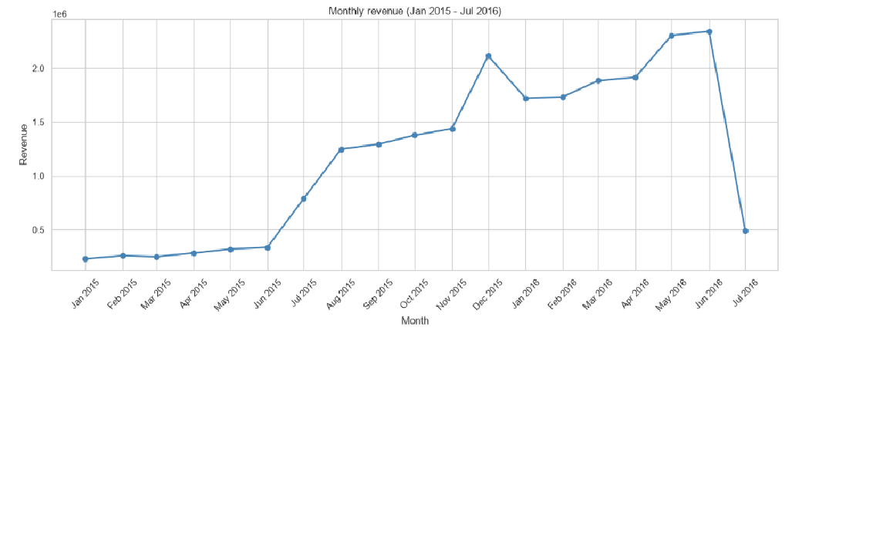

### Quarterly revenue trend
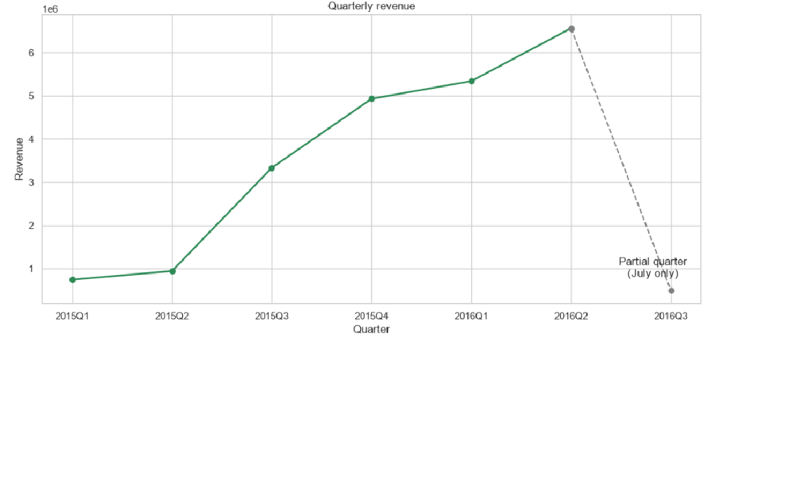

### Year-over-year comparison (January to June)
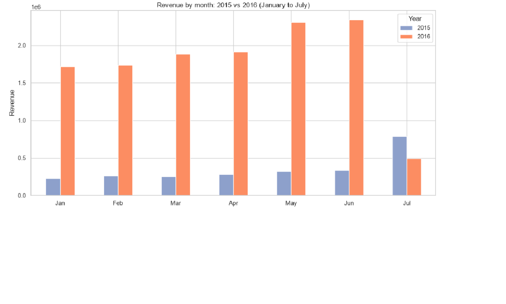

### Customer age distribution
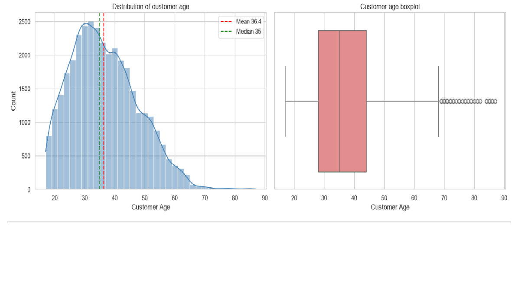

### Gender breakdown
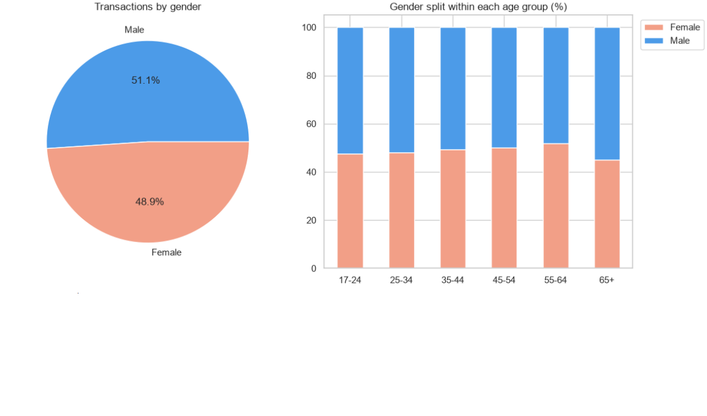

### Average revenue by age group and gender
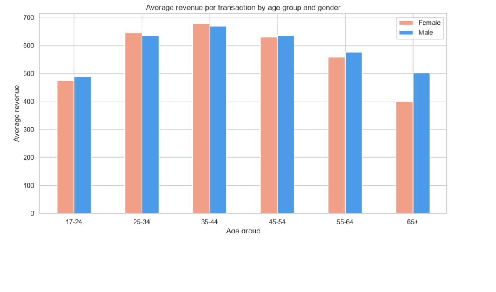

### Top 10 best-selling products (sub-categories)
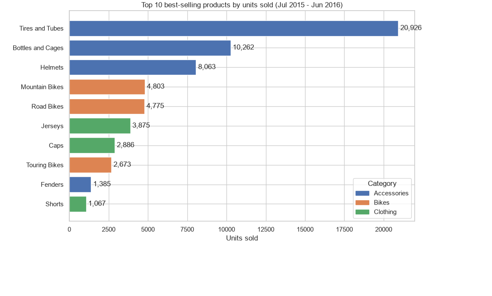

### Revenue by product category
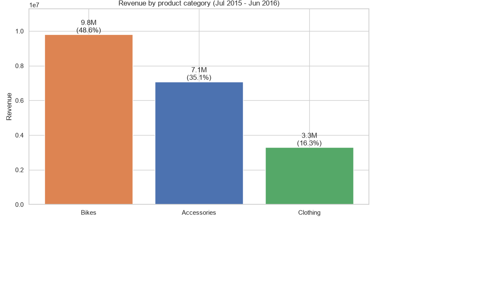

### Profit margin by sub-category
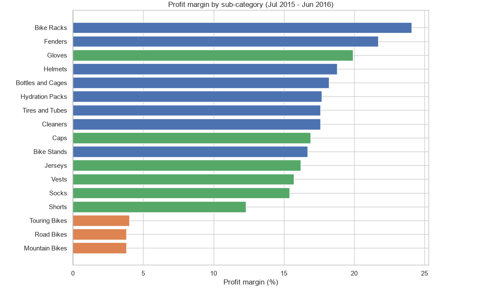

### Share of transactions, revenue and profit by category
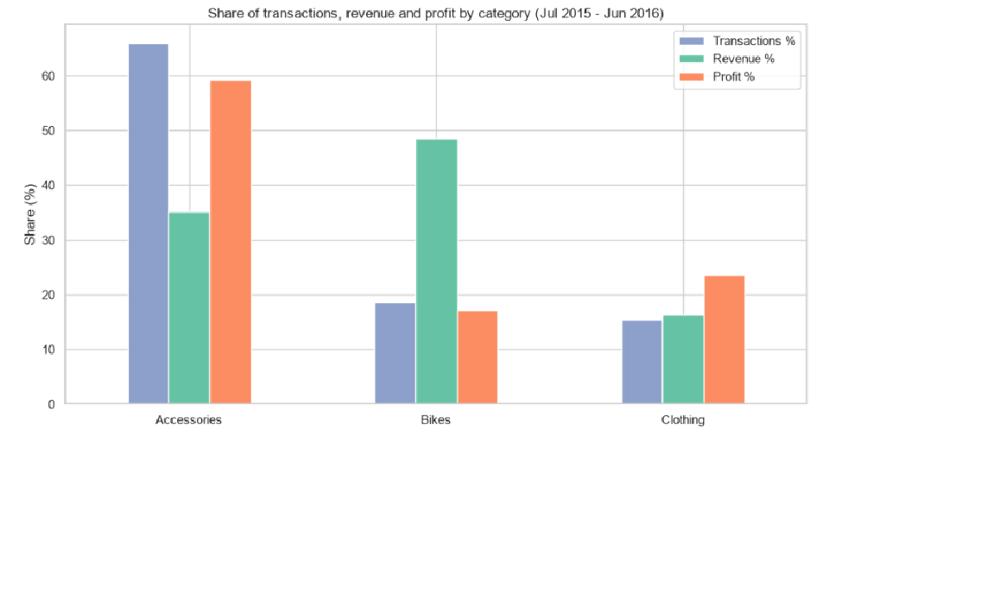

### Share of bike sales that lose money, by quarter
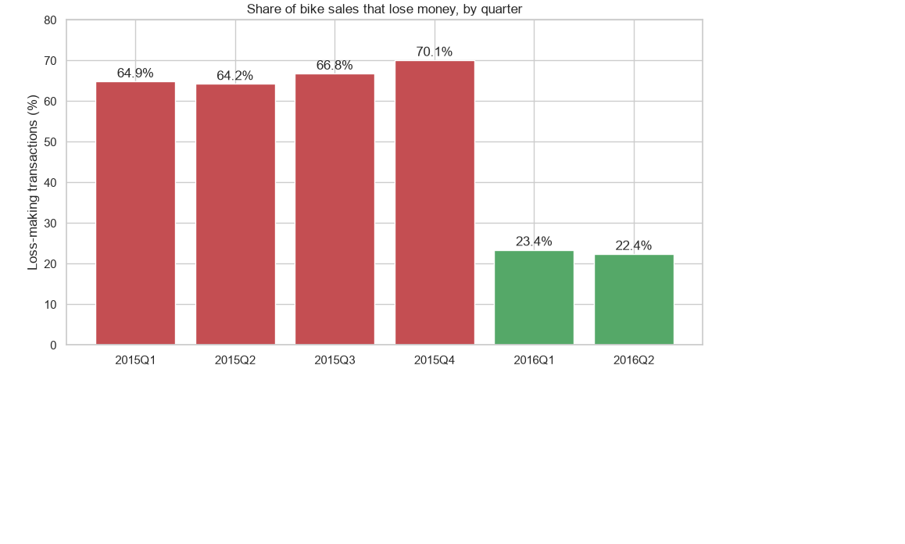

### Correlation heatmap (all numerical variables)
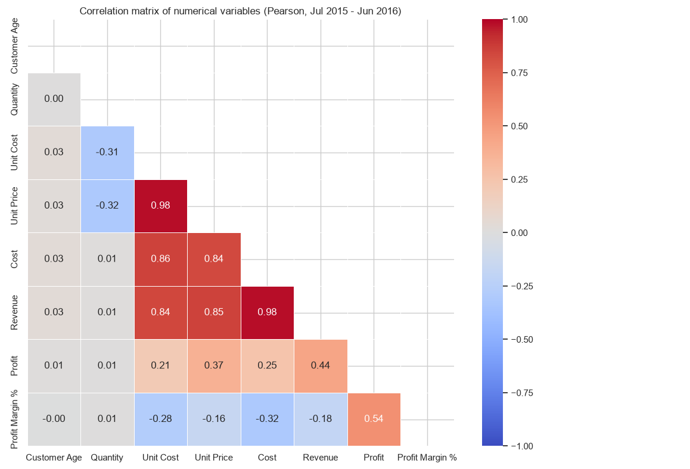

### Correlation heatmap (redundant columns removed)
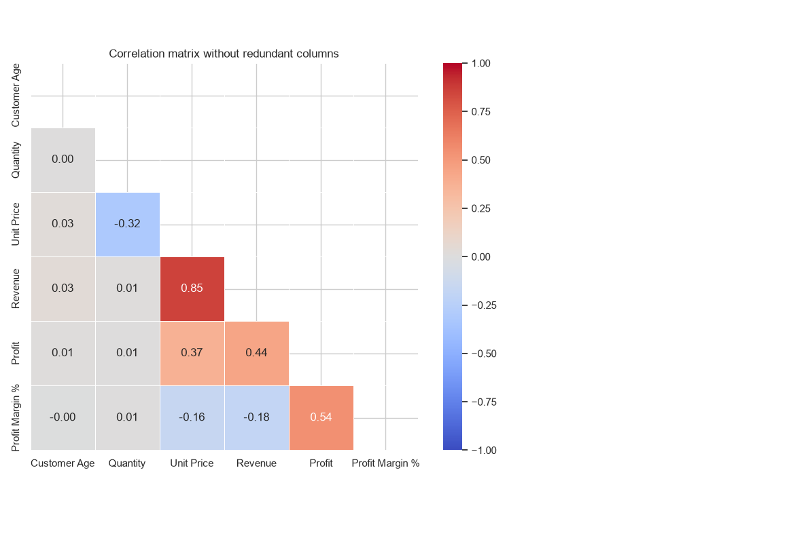

### Unit price vs profit margin
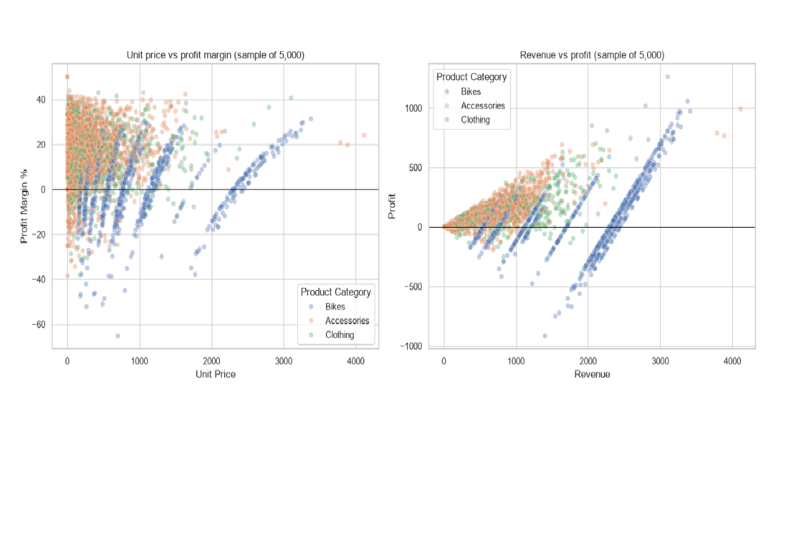
