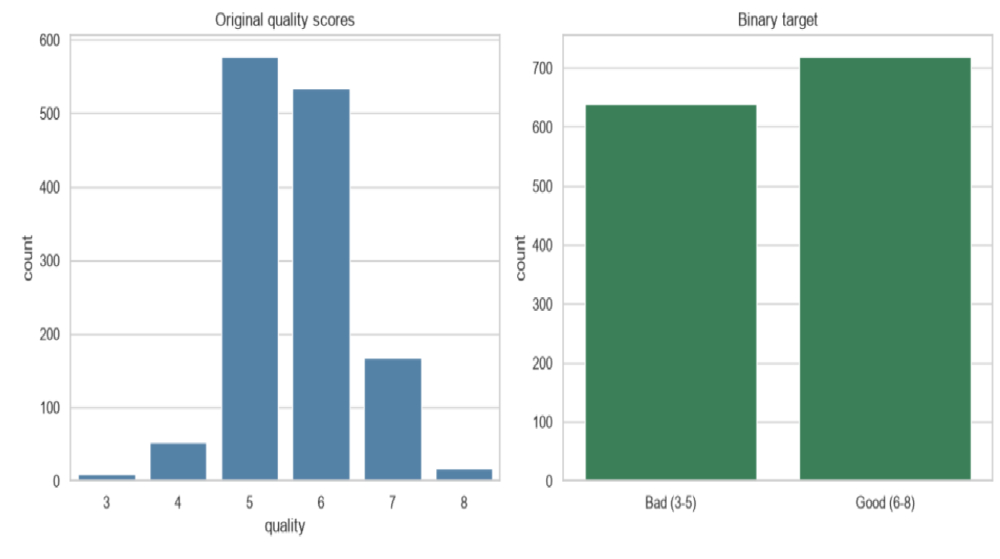
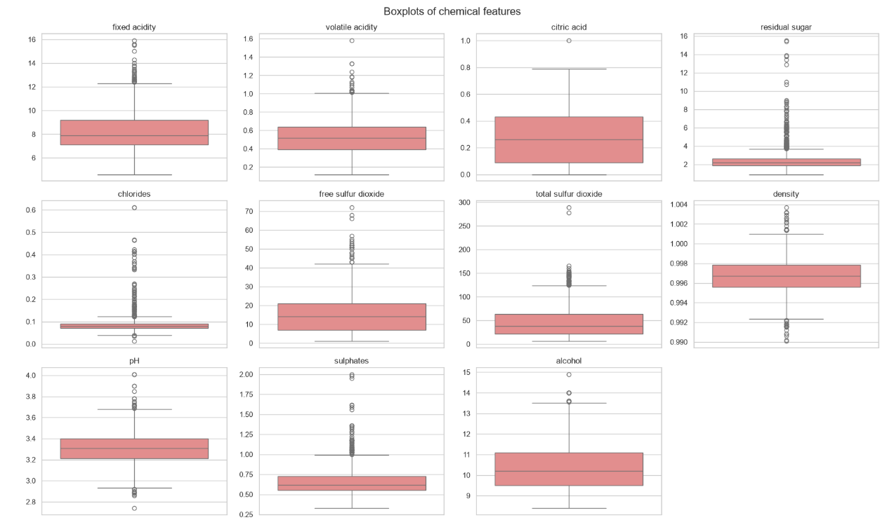
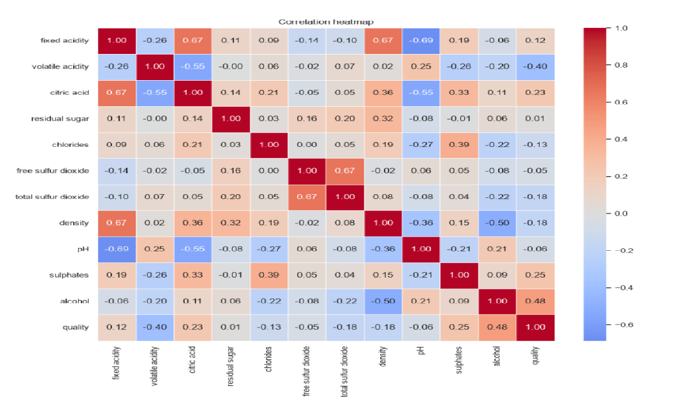
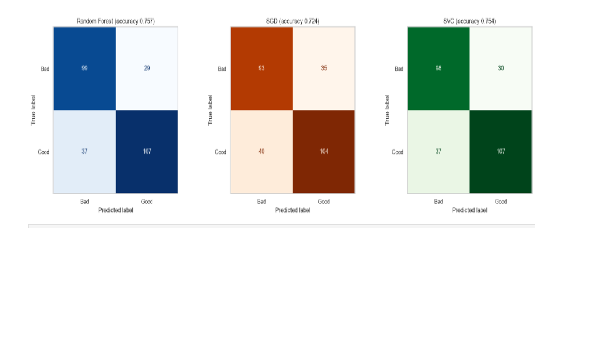
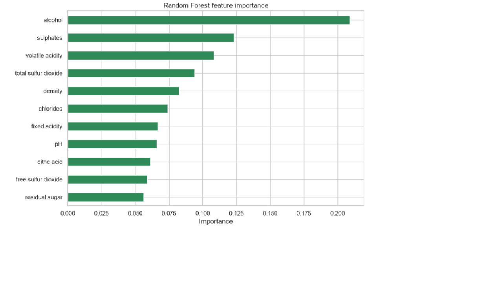
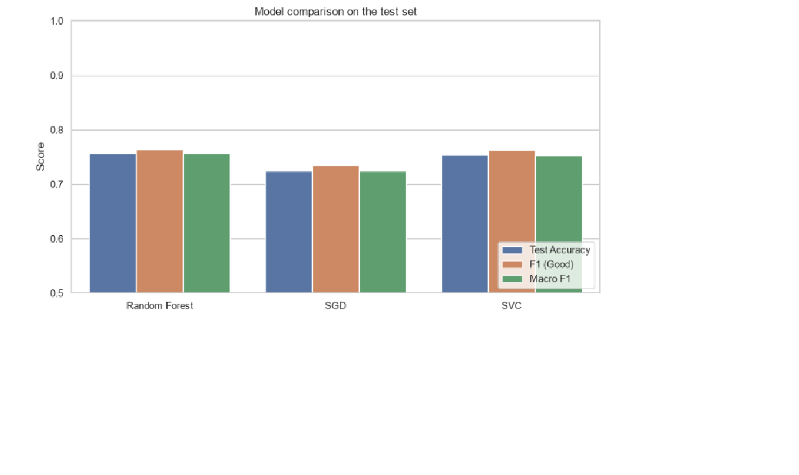

# Task 2 · Wine Quality Prediction

**Track:** Data Analytics · **Internship:** OIBSIP

## Objective
Train and compare multiple classification models to predict the quality of red wine from its physicochemical properties (acidity, density, alcohol content and others).

## Tech Stack
Python, pandas, numpy, scikit-learn (Random Forest, SGD, SVC), seaborn, matplotlib, Jupyter Notebook

## Dataset
[Wine Quality dataset (UCI Machine Learning Repository)](https://archive.ics.uci.edu/dataset/186/wine+quality), red wine file `winequality-red.csv`.

- 1,599 wines, 11 chemical features, quality score from 3 to 8
- 240 duplicate rows removed, leaving 1,359 wines

The CSV files are not included in this repository. Download them from UCI and place them in the `data/` folder.

## Project Structure
```
DataAnalytics-Task2-WineQualityPrediction/
├── Task2_Wine_Quality_Prediction.ipynb
├── README.md
├── requirements.txt
├── data/            (place the CSV files here)
└── screenshots/     (charts from the analysis)
```

## How to Run
```bash
pip install -r requirements.txt
jupyter notebook Task2_Wine_Quality_Prediction.ipynb
```
Then run all cells from top to bottom (Kernel → Restart & Run All).

## What the Notebook Covers
- [x] Load the dataset, inspect its structure and check the class distribution of quality scores
- [x] EDA: distribution plots for all chemical features, boxplots and a correlation heatmap
- [x] Class imbalance discussion and its effect on modelling
- [x] Feature engineering: quality binned into good (>= 6) vs bad (<= 5), with justification
- [x] Stratified train/test split (80/20)
- [x] Three classifiers: Random Forest, SGD and SVC
- [x] Evaluation: accuracy, classification report and confusion matrix for each model
- [x] Random Forest feature importance chart
- [x] Side-by-side comparison table, with 5-fold cross-validation
- [x] Conclusion: which model is most suitable for deployment and why

## Class Imbalance and Binning
About 82% of wines have quality 5 or 6, while quality 3, 4 and 8 together make up only 6% (10, 53 and 17 wines). A model that always predicts quality 5 would already reach 42.5% accuracy, so plain accuracy is misleading and the rare classes are too small to learn from or evaluate.

Quality was therefore binned into a binary target: **good (quality >= 6)** and **bad (quality <= 5)**. This gives a nearly balanced split (52.9% good, 47.1% bad). Splitting at 7 instead would leave only 13.5% good wines. The trade-off is that the model can no longer predict an exact score.

## Results

| Model | Test Accuracy | F1 (Good) | CV Accuracy (mean ± std) | Train-Test Gap |
|---|---|---|---|---|
| Random Forest | 0.757 | 0.764 | 0.744 ± 0.046 | 0.243 |
| SGD | 0.724 | 0.735 | 0.685 ± 0.042 | 0.016 |
| SVC | 0.754 | 0.762 | 0.746 ± 0.037 | 0.037 |

Test set: 272 wines. Cross-validation: 5-fold stratified, with scaling inside each fold.

### Key Findings
- **Random Forest and SVC are effectively tied.** Their test accuracies differ by one wine out of 272, and their cross-validation scores differ by far less than the fold-to-fold variation.
- **SGD is the weakest model**, about 3 points lower on the test set and about 6 points lower in cross-validation.
- **Random Forest overfits** (training accuracy near 100%), but its held-out performance is still as good as SVC's.
- **Alcohol (0.209), sulphates (0.123) and volatile acidity (0.108)** are the most important features and together account for 44.1% of total importance, which agrees with the correlation analysis.

## Recommendation
**Random Forest is recommended for deployment, with SVC as a close alternative.** Because accuracy cannot separate the two, the choice rests on practical factors: Random Forest needs no feature scaling at prediction time, its feature importances are interpretable for winemakers, and it handles skewed features and outliers without transformation. SVC is the better pick if consistent, lower-variance performance matters more than interpretability. SGD is not recommended because it is the least accurate.

## Limitations
- The target was binarised, so the model cannot predict an exact quality score.
- The dataset is small (1,359 wines) and covers only red wine, so results may not transfer to white wine.
- With a 272-wine test set, a difference of one or two wines is not meaningful, which is why cross-validation was added.
- Quality is a subjective tasting rating, which limits the accuracy any model can reach.
- Hyperparameters were mostly left at their defaults. Tuning (for example GridSearchCV, or limiting tree depth in Random Forest) could reduce overfitting and might change the ranking.

## Screenshots

### Class imbalance and binary target


### Feature distributions


### Correlation heatmap


### Confusion matrices


### Random Forest feature importance


### Model comparison

