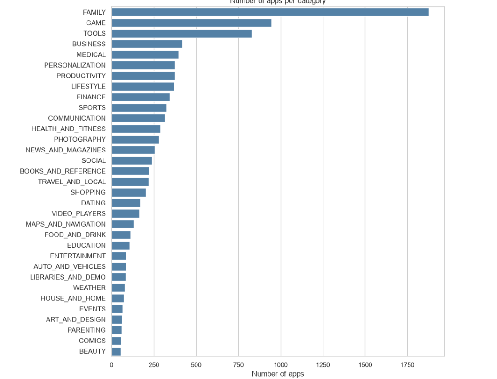
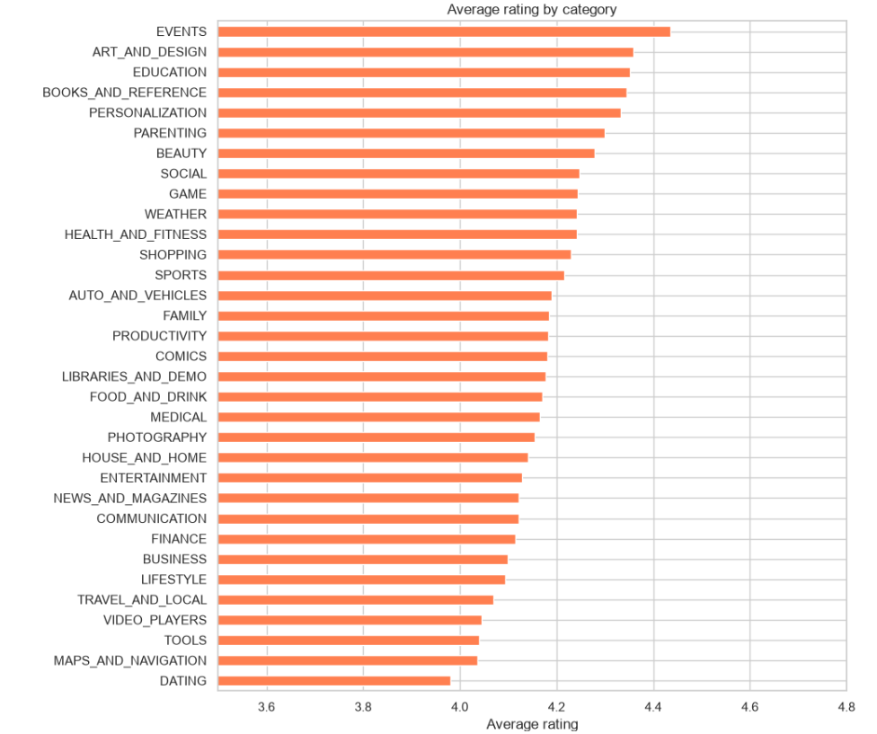
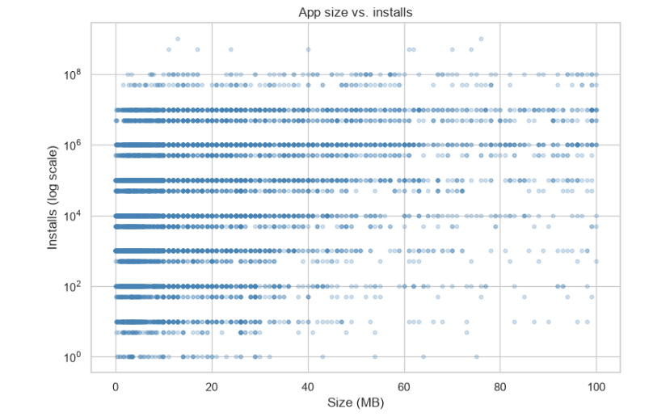
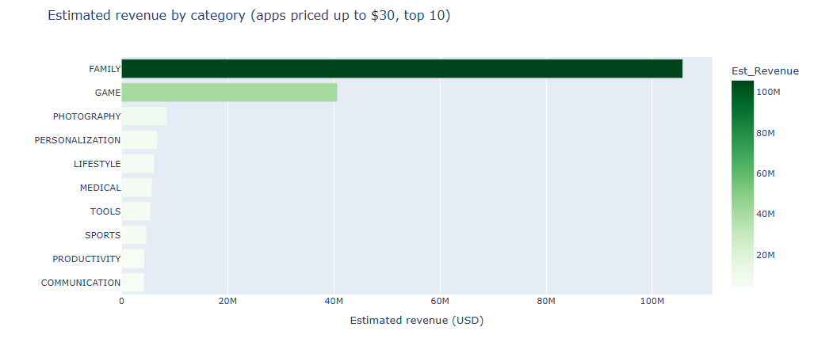
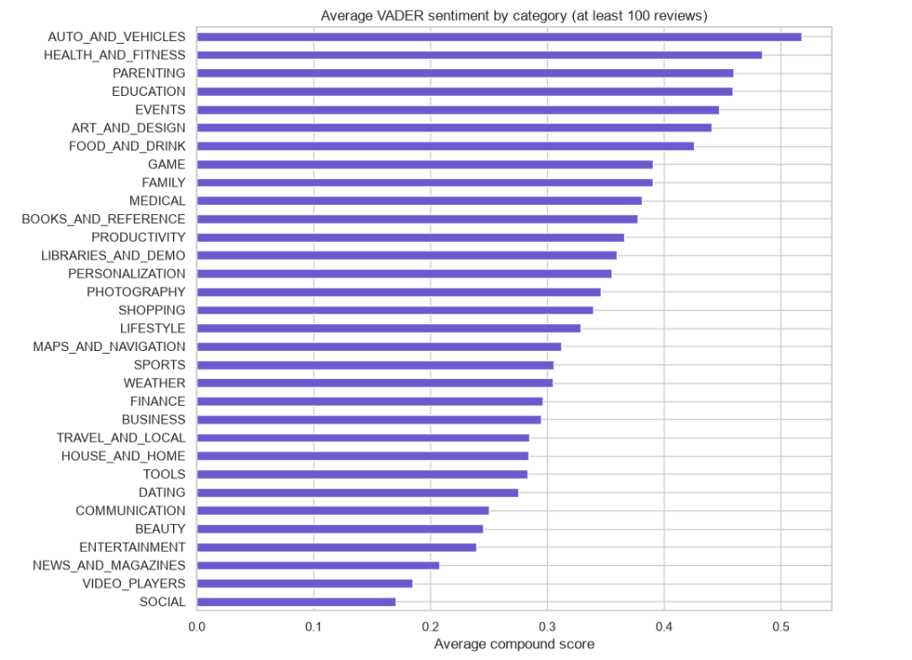

# Task 4 · Unveiling the Android App Market (Google Play Store Analysis)

**Track:** Data Analytics · **Internship:** OIBSIP

## Objective
Perform a data analysis of the Google Play Store ecosystem: clean messy real-world data, explore app categories, analyse ratings and pricing, estimate revenue, and run sentiment analysis on user reviews, in order to give data-driven advice to a developer planning to launch a new app.

## Tech Stack
Python, pandas, numpy, matplotlib, seaborn, plotly, VADER (vaderSentiment), Jupyter Notebook

## Dataset
Kaggle: [Google Play Store Apps](https://www.kaggle.com/lava18/google-play-store-apps) by Lavanya Gupta

- `googleplaystore.csv`: 10,841 rows, 13 columns (app details)
- `googleplaystore_user_reviews.csv`: 64,295 rows, 5 columns (user reviews)

The CSV files are not included in this repository. Download them from Kaggle and place them in the `data/` folder.

## Project Structure
```
DataAnalytics-Task4-PlayStoreAnalysis/
├── Task4_Google_Play_Store_Analysis.ipynb
├── README.md
├── requirements.txt
├── data/            (place the two CSV files here)
└── screenshots/     (charts from the analysis)
```

## How to Run
```bash
pip install -r requirements.txt
jupyter notebook Task4_Google_Play_Store_Analysis.ipynb
```
Then run all cells from top to bottom (Kernel → Restart & Run All).

## What the Notebook Covers
- [x] Load the apps and reviews datasets separately
- [x] Data cleaning: fixed data types (Installs, Price, Size, Reviews, Last Updated), handled nulls, removed duplicates and one corrupted row
- [x] Category analysis: app distribution and saturation
- [x] Ratings analysis: distribution and average rating by category
- [x] Size vs. installs: scatter plot and correlation
- [x] Pricing analysis: free vs. paid, price distribution, estimated revenue by category
- [x] Sentiment analysis of user reviews with VADER (positive / neutral / negative)
- [x] Sentiment by category
- [x] Interactive visualisations with Plotly
- [x] Conclusion: 3 data-driven insights for a developer

## Data Cleaning Summary
- Removed 1 corrupted row (columns shifted, Category = "1.9")
- Converted `Installs` ("10,000+") and `Price` ("$4.99") to numbers
- Converted `Size` ("19M", "201k") to megabytes; "Varies with device" left as missing
- Converted `Reviews` to numeric and `Last Updated` to datetime
- Removed duplicate apps by keeping the entry with the most reviews
- Left missing `Rating` and `Size` values empty instead of filling them, to avoid inventing data
- Dropped reviews with no text before sentiment scoring

## Key Findings
- **Category saturation:** FAMILY (19.4%), GAME (9.8%) and TOOLS (8.6%) are the most crowded categories.
- **Pricing:** 92.2% of apps are free; the median price of a paid app is $2.99.
- **Size vs. installs:** weak positive relationship (Spearman = 0.31).
- **Revenue (price x installs, apps priced up to $30):** highest in FAMILY (about $105.7M) and GAME (about $40.7M).
- **Sentiment:** most positive categories are AUTO_AND_VEHICLES (82.3% positive), EVENTS (80.1%) and HEALTH_AND_FITNESS (78.5%); least positive are SOCIAL (55.1%), VIDEO_PLAYERS (56.7%) and NEWS_AND_MAGAZINES (57.6%).

## Conclusion: 3 Insights for a Developer
1. **Avoid the crowded categories unless the app is clearly differentiated.** FAMILY, GAME and TOOLS hold about 38% of all apps, and ratings are similar across categories, so quality alone will not make a new app stand out. Mid-sized categories offer a better entry point.
2. **Build for free with in-app monetisation; price a paid app low.** With 92.2% of apps free and a median paid price of $2.99, paid apps are a small, price-sensitive niche. Paid revenue is concentrated in a few hit titles (for example Minecraft in FAMILY).
3. **Use review sentiment to find unmet user needs.** Categories with low positive sentiment (SOCIAL, VIDEO_PLAYERS, NEWS_AND_MAGAZINES) suggest users are dissatisfied with current apps, which leaves room for a better product. App size has only a weak link to installs, so it should not drive design decisions.

## Limitations
- Revenue is estimated as Price x Installs. Installs are reported as floor values (for example "10,000+"), and store fees and refunds are ignored, so this is a rough lower bound.
- Apps priced above $30 were excluded from the revenue analysis because novelty apps (for example "I am rich", $399.99) distort the totals.
- Only a subset of apps have user reviews, so sentiment by category covers fewer categories than the other analyses. Categories with fewer than 100 reviews were left out.
- The data was scraped in 2018, so current market conditions may differ.

## Screenshots

### Apps per category


### Ratings distribution


### Size vs. installs


### Estimated revenue by category


### Review sentiment (VADER)


### Sentiment by category

